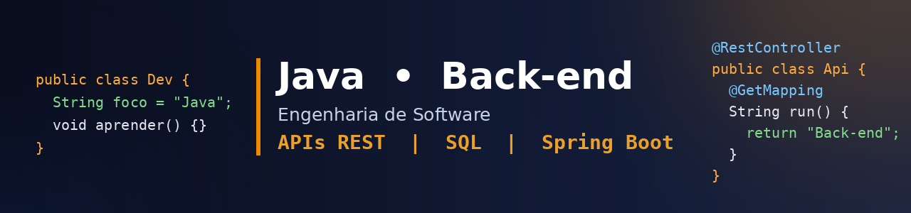

<h1 align="center">Olá, eu sou Guilherme Augusto Padilha 👋</h1>

  Estudante de Engenharia de Software (CEUNSP) • Desenvolvedor Back-end Java ☕ 
  Apaixonado por construir APIs, resolver problemas e escrever código limpo.

  
  

---

## 🧑‍💻 Sobre mim

- 🎓 Cursando **Engenharia de Software** no **CEUNSP** (2º Semestre/previsão de formatura para 2030)
- ☕ **Java** é minha linguagem principal e o back-end é onde eu mais gosto de atuar
- 🗄️ Experiência com **bancos de dados** (nível básico/intermediário)
- 🌐 Conhecimento básico de front-end e do protocolo HTTP
- 🤖 Estudando e aplicando **Inteligência Artificial**
- 🌎 Inglês: básico, em evolução (leio documentação técnica)
- 🔎 **Buscando oportunidade de estágio/júnior em desenvolvimento back-end**

---

## 🛠️ Tecnologias

**Principal**

**Bancos de dados**

**Outras linguagens**

**Front-end (básico)**

**Ferramentas**

---

## 📊 GitHub Stats

  
  

---

## 🎯 Foco atual

- Aprofundar em **Spring Boot**, **JPA/Hibernate** e arquitetura de APIs REST
- Testes automatizados (**JUnit/Mockito**)
- Melhorar meu inglês técnico
- Construir projetos que resolvam problemas reais

---

  💬 Vamos conversar? Me chame no LinkedIn ou por e-mail!

